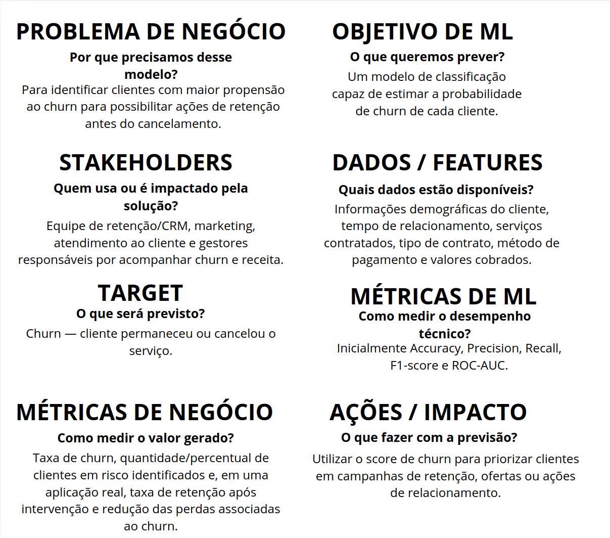

# Tech Challenge 1 — Predição de Churn

Projeto desenvolvido durante a primeira fase da pós-graduação em Machine Learning. O objetivo é analisar dados de clientes de uma empresa de telecomunicações e desenvolver uma solução de classificação capaz de identificar clientes com maior propensão ao churn.

# Objetivo

O problema é formulado como uma classificação binária:

`No`: o cliente permaneceu na empresa;

`Yes`: o cliente apresentou churn.

A variável `Churn Label` é utilizada como único target. A classe `Yes` é considerada a classe positiva.

## ML Canvas

O ML Canvas foi elaborado para documentar a relação entre o
problema de negócio, os stakeholders, os dados disponíveis,
o objetivo de Machine Learning e as métricas de sucesso.

